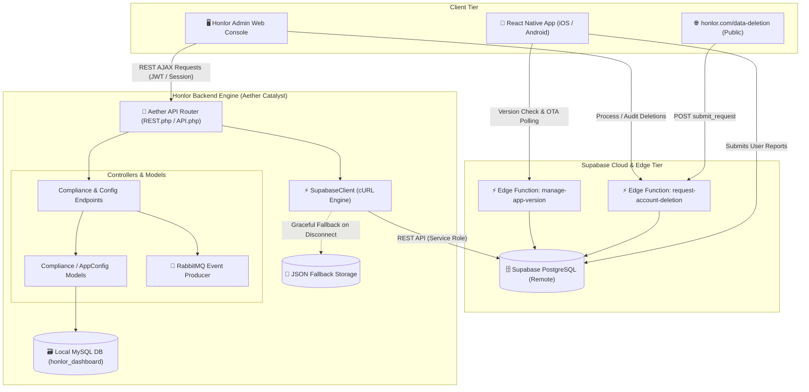

<div align="center">

  

  # Honlor Admin Workspace 🛡️
  
  **Next-Generation Administrative Console & Orchestration Engine for Honlor Messaging**

  [](https://www.php.net/)
  [](FRAMEWORK_DOCUMENTATION.md)
  [](https://supabase.com)
  [](https://www.rabbitmq.com/)
  [](https://tinode.co/)
  [](#-zero-trust-rbac-security)

  <br />

  <p align="center">
    <a href="#-key-capabilities"><b>Explore Features</b></a> •
    <a href="#-architectural-overview"><b>Architecture Flow</b></a> •
    <a href="#-the-four-pillars"><b>The Four Pillars</b></a> •
    <a href="#-quick-start"><b>Quick Start</b></a> •
    <a href="#-directory-structure"><b>Folder Layout</b></a> •
    <a href="FRAMEWORK_DOCUMENTATION.md"><b>Framework Docs</b></a>
  </p>

</div>

---

## 🌟 Overview

The **Honlor Admin Workspace** is an enterprise-grade, high-performance administrative command dashboard engineered specifically for **Honlor** — a privacy-first, decentralized real-time messaging ecosystem. 

Powered by the custom **Aether Catalyst** PHP 8.1+ MVC architecture, the platform marries strict separation of concerns with a cyberpunk-inspired dark/neon interface accelerated by Vanilla ES6+ and GSAP animations. It empowers operations teams to govern user trust & safety, coordinate dynamic channel topologies, broadcast cross-platform notifications, enforce GDPR account deletion lifecycles, and monitor distributed infrastructure in real time.

---

## ⚡ Key Capabilities

<table>
  <tr>
    <td width="50%">
      <h3>🛡️ User Vault & Moderation</h3>
      <ul>
        <li>Inspect detailed user identity profiles and device metadata.</li>
        <li>One-click freeze, unfreeze, and permanent account termination.</li>
        <li>Shadowban enforcement and suspicious activity heuristics.</li>
        <li>Clearance management with zero-trust permission barriers.</li>
      </ul>
    </td>
    <td width="50%">
      <h3>📡 Channel & Group Orchestration</h3>
      <ul>
        <li>Real-time room telemetry across public, private & encrypted groups.</li>
        <li>Direct participant moderation and message broadcast controls.</li>
        <li>Channel ownership transfers and automated inactive room recycling.</li>
        <li>Flagged content triage directly hooked into live chat feeds.</li>
      </ul>
    </td>
  </tr>
  <tr>
    <td width="50%">
      <h3>📢 Monetization & Ad Campaigns</h3>
      <ul>
        <li>Create, schedule, and optimize sponsored feed placements.</li>
        <li>Real-time CTR, impression tracking, and CPM conversion graphs.</li>
        <li>Granular targeting filters by client version, locale, and user cohorts.</li>
        <li>Automated budget pacing and ad creative asset validation.</li>
      </ul>
    </td>
    <td width="50%">
      <h3>⚖️ GDPR & Account Deletion Pipeline</h3>
      <ul>
        <li>End-to-end data deletion queue powered by Supabase Edge Functions.</li>
        <li>Automated cryptographic scrubbing of message histories and media.</li>
        <li>Public self-service request pipeline (<a href="https://honlor.com/data-deletion"><code>honlor.com/data-deletion</code></a>).</li>
        <li>Immutable deletion audit receipts with timestamped verifications.</li>
      </ul>
    </td>
  </tr>
  <tr>
    <td width="50%">
      <h3>📱 OTA App Version Control</h3>
      <ul>
        <li>Dynamic version gating with multi-row release history.</li>
        <li>Instant rollouts of mandatory vs. optional client updates.</li>
        <li>Immediate edge propagation to mobile clients via Supabase Deno functions.</li>
        <li>Global emergency maintenance-mode switch with custom client banners.</li>
      </ul>
    </td>
    <td width="50%">
      <h3>🚦 Real-Time Infrastructure Pulse</h3>
      <ul>
        <li>Live latency and health checks across critical dependencies:
          <ul>
            <li><b>Supabase</b> (PostgreSQL Database & Realtime Listeners)</li>
            <li><b>Tinode IM</b> (Websocket Gateway & Session Cluster)</li>
            <li><b>Firebase FCM</b> (Global Push Delivery Pipeline)</li>
            <li><b>RabbitMQ</b> (Asynchronous Event Broker)</li>
            <li><b>MySQL</b> (Local Transactional State Engine)</li>
          </ul>
        </li>
      </ul>
    </td>
  </tr>
</table>

---

## 🏛️ Architectural Overview

Honlor Admin Panel bridges front-end browser clients, remote mobile applications, distributed cloud edge workers, and local storage pools through a resilient asynchronous bus:



---

## 💎 The Four Pillars: Soul, Heart, Bridge & Face

The workspace adheres to **Aether Catalyst's** strict separation between framework core, domain models, and presentation:

```
┌────────────────────────────────────────────────────────────────────────┐
│                          AETHER CATALYST                               │
├─────────────────┬──────────────────┬─────────────────┬─────────────────┤
│    🧬 THE SOUL   │   ❤️ THE HEART    │   🌉 THE BRIDGE  │   🎭 THE FACE    │
│  libs/src/      │  libs/app/       │  libs/api/      │  _templates/    │
├─────────────────┼──────────────────┼─────────────────┼─────────────────┤
│ • Database (PDO)│ • User & Role    │ • REST Closures │ • Master Views  │
│ • Session Engine│ • Channel & Ad   │ • Route Guards  │ • Admin Pages   │
│ • WebAPI / REST │ • Message & Stat │ • Input Triage  │ • ToastV3 Engine│
│ • SupabaseClient│ • AppConfig      │ • JSON Payload  │ • GSAP Cyber-UI │
│ • Mailer (SMTP) │ • Compliance     │   Emitters      │ • Modal Dialogs │
└─────────────────┴──────────────────┴─────────────────┴─────────────────┘
```

| Pillar | Directory | Responsibility | Constraint |
| :--- | :--- | :--- | :--- |
| **The Soul** | `htdocs/libs/src/` | Foundational framework engines: session security, database pooling, REST utilities, external service drivers. | **Immutable**. Strictly no application-specific tables or business rules. |
| **The Heart** | `htdocs/libs/app/` | Domain-specific application entities, business rules, and analytical aggregators. | Houses all SQL queries and business logic for Honlor models. |
| **The Bridge** | `htdocs/libs/api/` | Action controllers called via `/api/*` endpoints; validates parameters and returns JSON responses. | Must only orchestrate models; never render presentation HTML. |
| **The Face** | `htdocs/_templates/`| Visual presentation views, modular UI partials, modals, and cyber-styled layout templates. | Pure presentation; no direct database mutations or raw business logic. |

> 📖 **Deep Dive**: Learn more about the framework conventions in [FRAMEWORK_DOCUMENTATION.md](FRAMEWORK_DOCUMENTATION.md).

---

## 🧰 Technology Stack

<div align="center">

| Layer | Technologies |
| :--- | :--- |
| **Backend Core** | PHP 8.1+, Aether Catalyst MVC, Composer, PSR-4 Autoloading |
| **Databases** | MySQL 8.0+ (Local transactional state), Supabase (PostgreSQL 15 Cloud) |
| **Edge Functions** | Deno runtime, TypeScript, Base64url JWT verification |
| **Asynchronous Bus** | RabbitMQ (`php-amqplib`), Background Cron Workers |
| **Realtime & Messaging** | Tinode IM Engine, Firebase Cloud Messaging (FCM Push) |
| **Frontend UI** | Modern Vanilla JavaScript (ES6+), Tailwind CSS, Vanilla CSS, GSAP |
| **Security & Auth** | Zero-Trust Role-Based Access Control (RBAC), Argon2id / Bcrypt |
| **Testing & Quality** | PHPUnit (Unit & Integration Suites), Mock JSON Fallback Engine |

</div>

---

## 🔐 Zero-Trust RBAC & Security

Access throughout the Honlor Admin Workspace is governed by an explicit **Resource-Action Permission Matrix** (`Session::hasPermission($resource, $action)`):

```
User Request ──► Session Active? ──► Dynamic Route Guard ──► Permission Matrix ──► Allowed
                      │                      │                       │
                     No                     No                      No
                      ▼                      ▼                       ▼
                 Login Gate            403 Forbidden            403 / Redirect
```

- **Granular Permissions**: Permissions are scoped by capability (e.g., `users:view`, `users:manage`, `deletion:manage`, `app_config:sync`).
- **Dynamic Nav Filtering**: Administrative sidebar items automatically hide from operators who lack required clearance.
- **API Guard Rails**: Direct JSON requests validate actor role permissions prior to controller execution, preventing privilege escalation.

---

## 📦 Getting Started

### Prerequisites

- **PHP**: `^8.1` with extensions: `pdo_mysql`, `curl`, `mbstring`, `json`, `sockets`
- **MySQL / MariaDB**: `^8.0`
- **Composer**: `^2.5`
- **Node.js & NPM** *(Optional, for frontend asset rebuilding)*: `^18.0`

### 1. Repository Setup

```bash
# Clone the repository
git clone https://github.com/honlor/honlor-admin-panel.git
cd honlor-admin-panel

# Install PHP dependencies
composer install -d htdocs
```

### 2. Environment Configuration

The workspace utilizes both environment variables (`.env`) and framework configuration (`project/config.json`):

```bash
# Set up development configuration file
cp project/config.json.template project/config.json

# Copy environment variable template (if present) or edit root .env
nano .env
```

#### Key `.env` Configuration Reference

```env
# Local Database
DB_SERVER=localhost
DB_PORT=3306
DB_NAME=honlor_dashboard
DB_USER=honlor_admin
DB_PASS=your_secure_password

# Supabase Cloud Integration
SUPABASE_URL=https://your-project.supabase.co
SUPABASE_ANON_KEY=eyJhbGciOi...
SUPABASE_SERVICE_ROLE_KEY=eyJhbGciOi...

# Tinode & Messaging Endpoints
TINODE_API_URL=http://localhost:6060/v0/
FIREBASE_SERVER_KEY=AAAA...

# RabbitMQ Message Broker
RABBITMQ_HOST=localhost
RABBITMQ_PORT=5672
RABBITMQ_USER=guest
RABBITMQ_PASS=guest
```

### 3. Database Initialization

Import the baseline schemas and initial roles to your MySQL instance:

```bash
# Execute schema migration scripts
mysql -u honlor_admin -p honlor_dashboard < htdocs/db/schema.sql

# Optional: Run schema update scripts if syncing migrations
php htdocs/update_db.php
```

### 4. Running the Development Server

You can run the web server using Apache, Nginx, or PHP's built-in development server pointing to the `htdocs` document root:

```bash
php -S 0.0.0.0:8000 -t htdocs/
```

Access the admin dashboard in your browser:
👉 **`http://localhost:8000/login.php`**

---

## 📂 Directory Structure

```text
honlor-admin-panel/
├── .env                              # Environment secret overrides
├── ARCHITECTURE_DOCUMENTATION.md     # Deep architecture and system integration guide
├── ARCHITECTURE_DIAGRAM.mmd          # Mermaid architecture source
├── CHANGELOG.md                      # Release log with versioned migration notes
├── FRAMEWORK_DOCUMENTATION.md        # Aether Catalyst development reference
├── README.md                         # Workspace entry documentation
│
├── htdocs/                           # 🌐 Public Web Root (Only folder exposed to web server)
│   ├── index.php                     # Default portal landing page
│   ├── login.php                     # Authentication challenge controller
│   ├── admin.php                     # Central dashboard dispatcher & RBAC router
│   ├── api.php                       # REST API master entry point
│   │
│   ├── _templates/                   # 🎭 The Face: Presentation Views
│   │   ├── _masterForAdmin.php       # Master admin layout shell (sidebar, topbar, toast)
│   │   └── admin/                    # Page templates
│   │       ├── dashboard.php         # Real-time infrastructure telemetry & metrics
│   │       ├── users.php             # User moderation and vault controls
│   │       ├── channels.php          # Chat channel inspection and management
│   │       ├── ads.php               # Ad campaigns and impression analytics
│   │       ├── deletion_requests.php # GDPR data purge orchestration
│   │       ├── app_config.php        # Mobile OTA updates and version flags
│   │       └── settings.php          # Platform configurations & API credential keys
│   │
│   ├── libs/                         # 🧠 Autoloaded Core & Application Modules
│   │   ├── src/                      # 🧬 The Soul: Core Framework Engine (Immutable)
│   │   │   ├── Database.php          # PDO database wrapper & transaction manager
│   │   │   ├── Session.php           # Session persistence & RBAC verification
│   │   │   ├── REST.php              # JSON response formatter & HTTP headers
│   │   │   └── SupabaseClient.php    # Resilient Supabase REST client with mock fallback
│   │   │
│   │   ├── app/                      # ❤️ The Heart: Domain Business Models
│   │   │   ├── User.php              # User profile models and permission mapping
│   │   │   ├── Ad.php                # Campaign entity and tracking rules
│   │   │   ├── AppConfig.php         # Version sync & app status flags
│   │   │   └── Compliance.php        # Data-deletion request handler
│   │   │
│   │   └── api/                      # 🌉 The Bridge: REST Action Controllers
│   │       ├── app_config/           # Version and status update handlers
│   │       ├── users/                # Moderation action controllers
│   │       └── deletion/             # GDPR purge execution endpoints
│   │
│   ├── assets/                       # Publicly served static stylesheets, scripts, icons
│   └── db/                           # SQL migrations and database schema definitions
│
├── project/                          # 🛠️ Development Workspace (Offline build configs & tests)
│   ├── config.json                   # Shared application configuration file
│   └── js/ / css/                    # Uncompiled frontend source assets
│
├── supabase/                         # ⚡ Cloud Edge Functions (Deno Runtime)
│   └── functions/
│       ├── request-account-deletion/ # Public request intake & service-role processor
│       └── manage-app-version/       # App version verification & telemetry
│
└── tests/                            # 🧪 Quality Assurance & Automated Testing
    ├── Unit/                         # Core framework and model unit tests
    └── Integration/                  # End-to-end API route testing
```

---

## 🧪 Testing & Quality Assurance

Run the test suite to verify model integrity and API endpoints:

```bash
# Execute PHPUnit test suites
./htdocs/vendor/bin/phpunit tests/Unit
./htdocs/vendor/bin/phpunit tests/Integration
```

---

## 🤝 Contribution & Git Standards

This repository strictly enforces a semantic commit message convention:

```
[Category] : [Location / Module] -> [What Changes Were Made]
```

### Format Standards:
- **Category**: `New` (feature), `Major` (breaking/major overhaul), `Minor` (maintenance/logic fix), `Minor UI` / `Major UI` (visual upgrades).
- **Location**: Affected module (e.g., `Admin`, `Navbar`, `AppConfig`, `SupabaseClient`).
- **Title Case**: Capitalize the first letter of each word in the message.

```bash
# Example Commit Messages:
git commit -m "New : Admin -> Dynamic OTA App Version Sync Engine Implemented"
git commit -m "Major : SupabaseClient -> Automatic Failover to JSON Mock Storage Added"
git commit -m "Minor UI : Sidebar -> Lucide Icons & Neon Hover Glow States Polished"
```

---

## 📄 License & Attribution

Internal and proprietary software engineered for the **Honlor Network**. All rights reserved. Built with the **Aether Catalyst Framework**.

<div align="center">
  <sub>Engineered with precision for the Honlor Privacy-First Messaging Ecosystem.</sub>
</div>